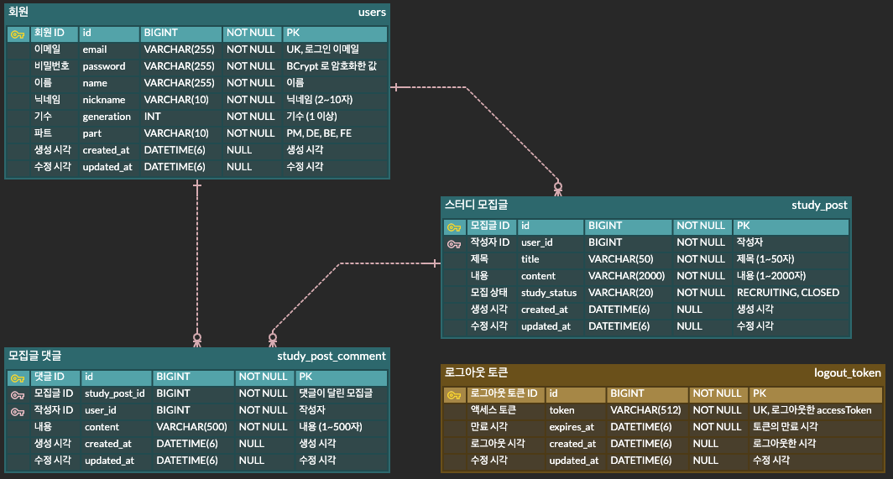

# ERD

- ERDCloud 링크: https://www.erdcloud.com/d/vjrEfYQAFpsLXAwRE



아래 표는 실제 엔티티(`backend/src/main/java/com/cotato/backend14th/domain/**/entity/`)와 같다. 테이블이 바뀌면 이 문서와 ERD 를 같이 고친다.

## 관계

```
users (1) ---< (N) study_post            users.id = study_post.user_id
users (1) ---< (N) study_post_comment    users.id = study_post_comment.user_id
study_post (1) ---< (N) study_post_comment    study_post.id = study_post_comment.study_post_id
logout_token    (다른 테이블과 관계 없음)
```

- 연관관계는 모두 `LAZY`, Enum 은 문자열로 저장한다.
- 모집글을 삭제하면 서비스에서 댓글을 먼저 일괄 삭제한다 (DB cascade 가 아니라 애플리케이션에서 처리).

## users

`user` 는 MySQL 예약어라서 테이블 이름을 `users` 로 둔다.

| 컬럼 | 타입 | 제약 | 설명 |
| --- | --- | --- | --- |
| `id` | BIGINT | PK, AUTO_INCREMENT | |
| `email` | VARCHAR(255) | NOT NULL, UNIQUE | 로그인 이메일 |
| `password` | VARCHAR(255) | NOT NULL | BCrypt 로 암호화한 값 |
| `name` | VARCHAR(255) | NOT NULL | 이름 |
| `nickname` | VARCHAR(10) | NOT NULL | 닉네임 (2~10자) |
| `generation` | INT | NOT NULL | 기수 (1 이상) |
| `part` | VARCHAR(10) | NOT NULL | `PM`, `DE`, `BE`, `FE` |
| `created_at` | DATETIME(6) | | 생성 시각 |
| `updated_at` | DATETIME(6) | | 수정 시각 |

## study_post

| 컬럼 | 타입 | 제약 | 설명 |
| --- | --- | --- | --- |
| `id` | BIGINT | PK, AUTO_INCREMENT | |
| `user_id` | BIGINT | NOT NULL, FK -> users.id | 작성자 |
| `title` | VARCHAR(50) | NOT NULL | 제목 (1~50자) |
| `content` | VARCHAR(2000) | NOT NULL | 내용 (1~2000자) |
| `study_status` | VARCHAR(20) | NOT NULL | `RECRUITING`, `CLOSED` |
| `created_at` | DATETIME(6) | | 생성 시각 |
| `updated_at` | DATETIME(6) | | 수정 시각 |

## study_post_comment

댓글이 곧 스터디 신청이다.

- 한 사용자가 같은 모집글에 댓글을 여러 개 남길 수 있다 (의도한 것). 명세가 별도의 신청 기능 없이 댓글을 신청으로 보므로, 질문과 추가 대화도 댓글로 할 수 있게 `(study_post_id, user_id)` 에 UNIQUE 를 걸지 않았다.

| 컬럼 | 타입 | 제약 | 설명 |
| --- | --- | --- | --- |
| `id` | BIGINT | PK, AUTO_INCREMENT | |
| `study_post_id` | BIGINT | NOT NULL, FK -> study_post.id | 댓글이 달린 모집글 |
| `user_id` | BIGINT | NOT NULL, FK -> users.id | 작성자 |
| `content` | VARCHAR(500) | NOT NULL | 내용 (1~500자) |
| `created_at` | DATETIME(6) | | 생성 시각 |
| `updated_at` | DATETIME(6) | | 수정 시각 |

## logout_token (추가한 테이블)

로그아웃한 accessToken 을 만료 시각까지 무효 처리하려고 추가했다. 요청마다 토큰이 이 테이블에 있는지 확인하고, 있으면 인증되지 않은 것으로 본다.

| 컬럼 | 타입 | 제약 | 설명 |
| --- | --- | --- | --- |
| `id` | BIGINT | PK, AUTO_INCREMENT | |
| `token` | VARCHAR(512) | NOT NULL, UNIQUE | 로그아웃한 accessToken |
| `expires_at` | DATETIME(6) | NOT NULL | 토큰의 만료 시각 |
| `created_at` | DATETIME(6) | | 로그아웃한 시각 |
| `updated_at` | DATETIME(6) | | 수정 시각 |

- 만료 시각이 지난 행은 지금 정리하지 않는다. 만료된 토큰은 JWT 검증에서 이미 거부되어 남아 있어도 동작에 영향이 없고, 과제 규모에서는 쌓이는 양이 적기 때문이다. 필요해지면 스케줄러(`@Scheduled`)로 `expires_at` 이 지난 행을 주기적으로 삭제하거나 Redis TTL 로 옮긴다.
