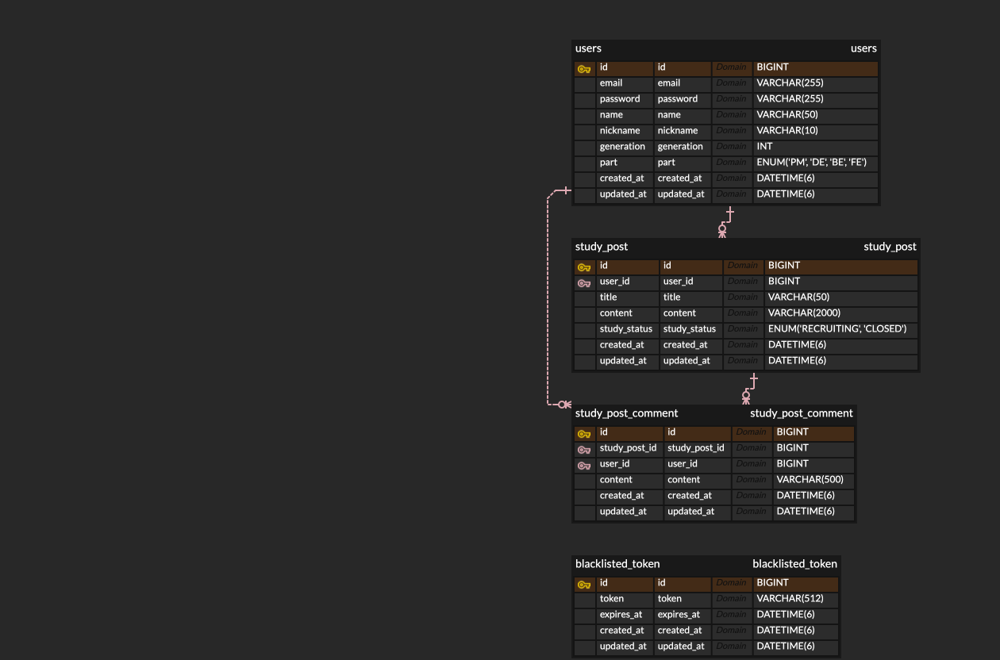

# ERD

- ERDCloud: https://www.erdcloud.com/d/fzsnp2T3R2djowcys
- 이미지: [`cotato.png`](./cotato.png)
- DDL: [`schema.sql`](./schema.sql) (엔티티에서 생성, ERDCloud 가져오기용)

## 테이블

### users

| 컬럼 | 타입 | 제약 | 설명 |
|---|---|---|---|
| id | BIGINT | PK, AUTO_INCREMENT | |
| email | VARCHAR(255) | NOT NULL, UNIQUE | |
| password | VARCHAR(255) | NOT NULL | BCrypt 해시 |
| name | VARCHAR(50) | NOT NULL | |
| nickname | VARCHAR(10) | NOT NULL | 2~10자 |
| generation | INT | NOT NULL | 1 이상 |
| part | ENUM('PM','DE','BE','FE') | NOT NULL | 문자열 Enum |
| created_at | DATETIME(6) | | |
| updated_at | DATETIME(6) | | |

> `user`는 MySQL 예약어라 테이블 이름은 `users`로 둔다. (엔티티 이름은 `User`)

### study_post

| 컬럼 | 타입 | 제약 | 설명 |
|---|---|---|---|
| id | BIGINT | PK, AUTO_INCREMENT | |
| user_id | BIGINT | FK → users.id, NOT NULL | 작성자 |
| title | VARCHAR(50) | NOT NULL | |
| content | VARCHAR(2000) | NOT NULL | |
| study_status | ENUM('RECRUITING','CLOSED') | NOT NULL | 문자열 Enum |
| created_at | DATETIME(6) | | |
| updated_at | DATETIME(6) | | |

### study_post_comment

| 컬럼 | 타입 | 제약 | 설명 |
|---|---|---|---|
| id | BIGINT | PK, AUTO_INCREMENT | |
| study_post_id | BIGINT | FK → study_post.id, NOT NULL | |
| user_id | BIGINT | FK → users.id, NOT NULL | 신청자(작성자) |
| content | VARCHAR(500) | NOT NULL | |
| created_at | DATETIME(6) | | |
| updated_at | DATETIME(6) | | |

### blacklisted_token (추가)

| 컬럼 | 타입 | 제약 | 설명 |
|---|---|---|---|
| id | BIGINT | PK, AUTO_INCREMENT | |
| token | VARCHAR(512) | NOT NULL, UNIQUE | 로그아웃한 accessToken |
| expires_at | DATETIME(6) | NOT NULL | 토큰 원래 만료 시각 |
| created_at | DATETIME(6) | | |
| updated_at | DATETIME(6) | | |

## 연관관계

- `users` 1 : N `study_post` (작성)
- `study_post` 1 : N `study_post_comment` (글 삭제 시 댓글 함께 삭제)
- `users` 1 : N `study_post_comment` (작성)
- 모든 연관관계는 `@ManyToOne(fetch = LAZY)` 단방향
