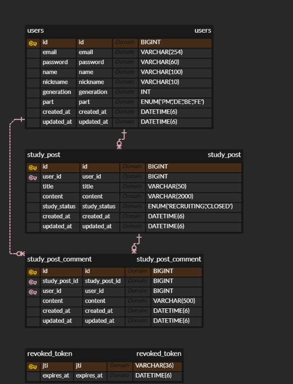

# 스터디 매칭 ERD

[ERDCloud 원본](https://www.erdcloud.com/d/awuzdbrW8ZtBbMJwc)은 작성자 계정의 비공개 다이어그램이다. 리뷰 시 아래 내보낸 이미지를 볼 수 있다.

- users.email은 유일하며 비밀번호는 BCrypt 해시로 저장한다.
- users와 study_post, users와 study_post_comment, study_post와 study_post_comment는 각각 1:N이다.
- study_post를 삭제하면 MySQL 외래 키의 ON DELETE CASCADE로 댓글을 함께 삭제한다.
- revoked_token의 jti는 JWT 식별자다. expires_at 인덱스는 로그아웃 시 만료된 기록을 정리하는 데 사용한다.
- book은 이전 과제의 연습용 테이블이다. 위 그림은 스터디 매칭 도메인의 테이블을 담는다.
